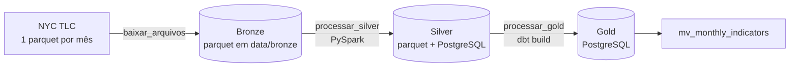

# Urban Mobility Analytics — Pipeline de corridas de táxi (NYC TLC)

Pipeline semanal em arquitetura medalhão para as corridas **Yellow Taxi** de Nova York
(1º semestre de 2025, 24 milhões de corridas): ingestão incremental dos arquivos da TLC,
tratamento com **PySpark**, carga em **PostgreSQL**, modelagem dimensional com **dbt** e
orquestração com **Airflow**, tudo em **Docker**.

## Sumário

1. [Arquitetura](#arquitetura)
2. [Stack e por que cada ferramenta](#stack-e-por-que-cada-ferramenta)
3. [Como executar](#como-executar)
4. [Estrutura do repositório](#estrutura-do-repositório)
5. [Camada bronze: ingestão incremental](#camada-bronze-ingestão-incremental)
6. [Camada silver: regras de qualidade](#camada-silver-regras-de-qualidade)
7. [Camada gold: modelo dimensional e indicadores](#camada-gold-modelo-dimensional-e-indicadores)
8. [Orquestração](#orquestração)
9. [Testes de qualidade](#testes-de-qualidade)
10. [Resultados da carga](#resultados-da-carga)
11. [Achados nos dados](#achados-nos-dados)
12. [Resiliência: uma queda no meio da carga](#resiliência-uma-queda-no-meio-da-carga)
13. [Decisões e premissas](#decisões-e-premissas)
14. [Evoluções futuras](#evoluções-futuras)

---

## Arquitetura



| Camada | Onde fica | Conteúdo |
| --- | --- | --- |
| Bronze | `data/bronze/yellow/year=YYYY/month=MM/*.parquet` + `bronze.ingestion_control` | Arquivos originais da TLC, sem alteração, e o controle do que já foi baixado |
| Silver | `data/silver/yellow_trips/` + schema `silver` | Todas as corridas com schema fixo, colunas derivadas e flags de qualidade; tabela de referência de pagamentos |
| Gold | schema `gold` | Fato, dimensões e a materialized view de indicadores |

A bronze é imutável e fica fora do banco. Ela é a fonte da verdade: qualquer camada
acima pode ser reconstruída a partir dela, como de fato aconteceu durante o desenvolvimento
(ver [Resiliência](#resiliência-uma-queda-no-meio-da-carga)).

## Stack e por que cada ferramenta

| Fase | Ferramenta | Por quê |
| --- | --- | --- |
| Ingestão | Python (`requests`, `pyarrow`) | Download em streaming com retentativas; o `pyarrow` valida o parquet lendo só o rodapé, sem carregar o arquivo |
| Tratamento | PySpark 4.0 | Processa milhões de linhas por mês com schema explícito; o mesmo código escala para um cluster sem reescrita |
| Armazenamento analítico | PostgreSQL 16 | Banco relacional com suporte nativo a materialized views, exigidas no item 7 |
| Modelagem | dbt Core 1.11 | Transformações versionadas em SQL, materialização incremental, testes declarativos e documentação no mesmo projeto |
| Orquestração | Airflow 3.3 | Agendamento semanal, dependências entre etapas, retentativas, parâmetros e histórico de execuções |
| Ambiente | Docker Compose | O Airflow não roda nativamente no Windows, e o avaliador reproduz tudo com um comando |

## Como executar

**Pré-requisitos:** Docker Desktop (Compose v2), cerca de 5 GB de memória para o Docker e
15 GB livres em disco.

```bash
cp .env.example .env              # no PowerShell: Copy-Item .env.example .env
docker compose build              # primeira vez: ~10 min
docker compose up airflow-init    # aguardar "exited with code 0"
docker compose up -d
```

1. Acesse o Airflow em http://localhost:8080 (`admin` / `admin`).
2. Ative a DAG `urban_mobility_pipeline` e use **Trigger** com os parâmetros padrão
   (`start_month = 2025-01`, `end_month = 2025-06`).
3. A primeira carga completa leva cerca de 1h15 numa máquina de 8 GB. As execuções
   seguintes só processam meses novos e terminam em poucos minutos.

> Ao ser ativada, a DAG executa a data agendada mais recente que já passou
> (comportamento do Airflow 3 com `catchup=False`). Isso é esperado e seguro.

**Banco do projeto:** `localhost:5433`, banco `urban_mobility`, usuário e senha `postgres`
(porta 5433 para não conflitar com um PostgreSQL local).

**Cada etapa também pode ser executada isoladamente:**

```bash
docker compose exec airflow-scheduler python -m src.ingestion.download_tlc --start 2025-01 --end 2025-06
docker compose exec airflow-scheduler python -m src.transform.silver_job --start 2025-01 --end 2025-06
docker compose exec airflow-scheduler bash -c 'cd /opt/airflow/dbt/urban_mobility && $DBT_BIN build --profiles-dir .'
```

**Validação rápida após a carga:**

```sql
SELECT
    (SELECT sum(row_count) FROM bronze.ingestion_control) AS bronze,
    (SELECT count(*) FROM silver.yellow_trips)             AS silver,
    (SELECT count(*) FROM gold.fct_trips)                  AS gold;   -- as três devem ser iguais

SELECT m.*, v.vendor_name
FROM gold.mv_monthly_indicators m
JOIN gold.dim_vendor v ON v.vendor_key = m.vendor_id
ORDER BY m.year_month, m.vendor_id;
```

## Estrutura do repositório

```text
urban-mobility/
├── dags/urban_mobility_pipeline.py      # item 8: DAG semanal
├── src/
│   ├── ingestion/download_tlc.py        # item 3: download incremental para a bronze
│   └── transform/silver_job.py          # item 5: job PySpark da silver
├── sql/init/                            # item 2 e 4: executados na 1ª subida do banco
│   ├── 01_schemas.sql                   #   schemas bronze/silver/gold + controle de ingestão
│   ├── 02_payment_type.sql              #   tabela de referência de pagamentos
│   └── 03_silver_tables.sql             #   tabelas da silver e métricas de qualidade
├── dbt/urban_mobility/                  # itens 6 e 7
│   ├── models/staging/                  #   leitura padronizada da silver (ephemeral)
│   ├── models/marts/core/               #   fato e dimensões
│   ├── models/marts/indicators/         #   materialized view de indicadores
│   ├── seeds/tlc_vendors.csv            #   fornecedores do dicionário da TLC
│   ├── macros/                          #   schema por camada e detecção de meses novos
│   └── tests/                           #   testes de regra de negócio
├── data/                                # gerado pelo pipeline (fora do git)
├── docker-compose.yaml
├── Dockerfile                           # Airflow + Java + PySpark + dbt em venv isolado
└── requirements.txt
```

## Camada bronze: ingestão incremental

`src/ingestion/download_tlc.py`, executado pela task `baixar_arquivos`.

- **Incremental:** consulta `bronze.ingestion_control` e pula os meses já baixados.
  Um mês só é pulado se também existir em disco, então apagar a pasta `data/` força o
  download de novo.
- **Download seguro:** grava num arquivo `.part` e só renomeia para o nome final depois de
  validar que é um parquet legível e com linhas. Uma interrupção nunca deixa arquivo
  corrompido na bronze.
- **Mês não publicado:** a TLC responde 403 para arquivos inexistentes. O mês é registrado
  como `not_available` sem derrubar o pipeline.
- **Falhas de rede:** até 3 retentativas com espera crescente; se ainda falhar, o mês fica
  como `failed` e a task termina com erro para o Airflow sinalizar.
- **Período configurável** por parâmetro (`--start`/`--end` ou parâmetros da DAG).

## Camada silver: regras de qualidade

`src/transform/silver_job.py`, executado pela task `processar_silver`.

**Princípio: sinalizar, nunca apagar.** A silver mantém todas as linhas da bronze, cada
uma marcada com `is_valid_trip` e `invalid_reason`. Assim é possível auditar: o total da
silver sempre bate com o da bronze.

### As 6 regras de qualidade

O critério de escolha foi: **cada regra protege um indicador ou agrupamento entregue na gold.**

| # | Código | Falha quando | Protege |
| --- | --- | --- | --- |
| 1 | `invalid_timestamps` | Embarque ou desembarque nulo, ou desembarque igual/anterior ao embarque | Duração e competência mensal |
| 2 | `pickup_outside_file_month` | Embarque fora do mês do arquivo de origem | Agrupamento mensal |
| 3 | `invalid_total_amount` | Valor total nulo ou negativo | Valor total e ticket médio |
| 4 | `non_positive_distance` | Distância nula, zero ou negativa | Distância média |
| 5 | `invalid_payment_type` | Tipo de pagamento nulo ou inexistente no dicionário da TLC (0 a 6) | Classificação da receita |
| 6 | `invalid_vendor_id` | Fornecedor nulo ou fora do domínio da TLC (1, 2, 6, 7) | Agrupamento por fornecedor |

Uma corrida pode violar várias regras: **todas** entram no `invalid_reason`, separadas por
`;`, com códigos fixos para permitir agrupar e contar.

**Regras avaliadas e descartadas:**

| Regra | Motivo do descarte |
| --- | --- |
| Quantidade de passageiros nula ou zero | Não afeta nenhum indicador pedido |
| Zona de embarque/desembarque fora de 1 a 265 | Não afeta nenhum indicador pedido (não há dimensão de localização) |
| Corridas duplicadas | A fonte não tem identificador único; detectar exige comparar todas as colunas e gera falso positivo. A duplicidade é **medida** nas métricas, não invalidada (0 duplicatas no semestre) |
| Valor total igual a zero | Pode ser legítimo (pagamento "No charge"); misturaria qualidade de dado com regra de receita |

### Anomalias: sinalizadas, não invalidadas

Duração acima de 6 horas (`is_duration_anomaly`) e distância acima de 100 milhas
(`is_distance_anomaly`) são **alertas**, não erros: são suspeitas, mas plausíveis. A corrida
continua válida e quem consome os dados decide o que fazer com a flag.

### Colunas derivadas e receita válida

`pickup_date`, `pickup_year_month` (competência `yyyymm` pela data de embarque),
`trip_duration_minutes`, `is_valid_payment`, `valid_revenue_amount`, as flags acima e
linhagem (`source_file`, `source_year_month`, `processed_at`).

**Receita válida** = `total_amount` somente quando a corrida é válida **e** o pagamento é
válido na tabela de referência (cartão ou dinheiro). Qualidade do dado (o valor existe e faz
sentido?) e regra de receita (esse pagamento conta?) são perguntas separadas: o domínio da
TLC responde a primeira, a tabela de referência da prova responde a segunda.

### Métricas, disjuntor e idempotência

- **Métricas por mês** em `silver.quality_metrics`: total, válidas, inválidas, percentual,
  falhas por regra, anomalias e duplicatas.
- **Disjuntor:** se mais de **10%** das corridas de um mês forem inválidas, o job grava as
  métricas e para antes de carregar o banco (configurável em `SILVER_MAX_INVALID_PCT`).
  O limite foi calibrado com os dados reais (~4% num mês normal).
- **Schema explícito:** os tipos das colunas mudam entre arquivos da TLC; o job aplica um
  schema fixo com `try_cast` e trata colunas ausentes em algum mês.
- **Carga idempotente:** o Spark carrega uma tabela de staging e a troca do mês
  (delete + insert) acontece numa única transação. Reprocessar um mês nunca duplica dados.
- **Incremental:** meses já carregados e sem novo download na bronze são pulados
  (`--force` reprocessa).

## Camada gold: modelo dimensional e indicadores

Projeto dbt em `dbt/urban_mobility`, executado pela task `processar_gold` (`dbt build`).

| Modelo | Tipo | Conteúdo |
| --- | --- | --- |
| `fct_trips` | Fato incremental | Uma linha por corrida (inclusive inválidas, sinalizadas), com métricas e chaves das dimensões |
| `dim_date` | Dimensão | Calendário com competência `yyyymm`, nomes de mês e dia em português |
| `dim_vendor` | Dimensão | Fornecedores da TLC (seed `tlc_vendors`) |
| `dim_payment_type` | Dimensão | Os 6 tipos da tabela da prova + o código 0 (Flex Fare), marcado como fora da referência |
| `mv_monthly_indicators` | Materialized view | Indicadores do item 7 por mês e fornecedor |

- **Membro "desconhecido" (-1)** em todas as dimensões: corridas com data ou fornecedor
  inválido apontam para ele, e a fato nunca tem chave estrangeira nula.
- **Fato incremental por mês:** só meses novos ou reprocessados na silver são carregados,
  substituindo o mês inteiro. Uma execução sem novidades faz `INSERT 0 0`.
- **Chave da corrida (`trip_id`):** hash do arquivo de origem com todas as colunas
  originais, validada por teste de unicidade.
- **A materialized view lê só a fato**, que nunca é recriada. Assim o dbt faz
  `REFRESH MATERIALIZED VIEW` a cada execução em vez de recriá-la.

### Definição dos indicadores

Todos calculados sobre **corridas válidas**, por competência da data de embarque.

| Indicador | Definição | Justificativa |
| --- | --- | --- |
| `total_trips` | Corridas válidas no mês | O controle de qualidade existe para isso |
| `total_valid_revenue` | Soma do `total_amount` com pagamento válido | Regra da prova |
| `avg_ticket` | Receita válida ÷ corridas **que geraram receita** | Dividir por todas as corridas misturaria quem não pagou (Flex Fare, "No charge") e reduziria o ticket de 27,71 para 20,77 (fev/2025, Curb) |
| `avg_distance_miles` | Média **sem as anomalias de distância** | Em fev/2025, as anomalias (o maior registro com 228 mil milhas em 18 minutos) elevavam a média da Curb de 3,14 para 7,12 milhas |

O nome do fornecedor vem da `dim_vendor` na consulta (ver [Como executar](#como-executar)).

## Orquestração

DAG `urban_mobility_pipeline`: `baixar_arquivos` → `processar_silver` → `processar_gold`.

- **Agendamento:** toda segunda-feira às 6h, com fuso explícito `America/Sao_Paulo`.
- **`catchup=False`** e **`max_active_runs=1`:** não executa semanas retroativas, e duas
  execuções nunca disputam os mesmos meses.
- **Parâmetros** `start_month` e `end_month`, alteráveis no disparo manual.
- **Spark em processo separado** (`BashOperator`): a JVM e sua memória são liberadas ao fim
  da task.
- **Retentativas e tempo limite por task;** os testes do `dbt build` funcionam como
  contrato de qualidade: se algum falhar, a execução falha.

## Testes de qualidade

- **Silver:** as 6 regras de linha, as métricas por mês e o disjuntor.
- **Gold:** 36 testes no `dbt build`:
  - 32 genéricos: chaves únicas e não nulas, integridade entre fato e dimensões, colunas
    obrigatórias nas fontes, no seed e na materialized view;
  - 4 de regra de negócio (`dbt/urban_mobility/tests`): a fato reconcilia com a silver mês
    a mês; só há receita em corrida e pagamento válidos; a materialized view tem uma linha
    por mês e fornecedor; a receita da view reconcilia com a fato.

## Resultados da carga

**Reconciliação entre camadas (1º semestre de 2025):**

| Camada | Corridas |
| --- | --- |
| Bronze | 24.083.384 |
| Silver | 24.083.384 |
| Gold (`fct_trips`) | 24.083.384 |

**Qualidade por mês:**

| Mês | Corridas | % inválidas |
| --- | --- | --- |
| 2025-01 | 3.475.226 | 4,34% |
| 2025-02 | 3.577.543 | 4,35% |
| 2025-03 | 4.145.257 | 4,56% |
| 2025-04 | 3.970.553 | 4,86% |
| 2025-05 | 4.591.845 | 6,67% |
| 2025-06 | 4.322.960 | 6,26% |

**Indicadores (fornecedores 1 e 2):**

| Mês | Fornecedor | Corridas válidas | Ticket médio | Distância média (mi) |
| --- | --- | --- | --- | --- |
| 202501 | Creative Mobile | 738.035 | 25,97 | 3,08 |
| 202501 | Curb Mobility | 2.586.040 | 27,78 | 3,19 |
| 202502 | Creative Mobile | 741.616 | 26,01 | 3,03 |
| 202502 | Curb Mobility | 2.680.131 | 27,71 | 3,14 |
| 202503 | Creative Mobile | 818.593 | 27,24 | 3,27 |
| 202503 | Curb Mobility | 3.137.417 | 28,88 | 3,35 |
| 202504 | Creative Mobile | 785.709 | 27,46 | 3,29 |
| 202504 | Curb Mobility | 2.991.426 | 29,22 | 3,39 |
| 202505 | Creative Mobile | 874.063 | 28,44 | 3,38 |
| 202505 | Curb Mobility | 3.411.237 | 30,72 | 3,59 |
| 202506 | Creative Mobile | 817.475 | 28,80 | 3,46 |
| 202506 | Curb Mobility | 3.233.681 | 30,55 | 3,65 |

O ticket médio sobe acompanhando a distância média ao longo do semestre: o valor por milha
fica estável, o que indica mudança no perfil das viagens e não erro de cálculo.

**Tempos da carga completa** (máquina de 8 GB): download 53 s, silver 1h02, gold 13 min.

## Achados nos dados

**1. Pagamento tipo 0 ("Flex Fare trip").** Em fevereiro de 2025, foram 806.937 corridas
(22,6% do mês). O código existe no dicionário da TLC, mas não na tabela de referência da
prova. Tratá-lo como erro levaria as inválidas de 4% para 25% do mês. Decisão: é corrida **válida**, mas
**não é pagamento válido**, logo não entra na receita. A tabela de referência da prova
ficou intacta.

**2. Anomalias de distância distorcem médias.** Poucos registros com centenas de milhares
de milhas em minutos dobram a distância média. Por isso a média é calculada sem as anomalias.

**3. Myle Technologies (fornecedor 6):** poucas centenas de corridas por mês, distância
média próxima de 9 milhas e nenhuma corrida com pagamento válido (ticket médio nulo).
Perfil de serviço diferente dos demais fornecedores.

**4. Helix (fornecedor 7): defeito sistêmico e risco operacional.** A Helix envia o
desembarque igual ao embarque em 100% das corridas, então todas falham na regra de datas e
o fornecedor não aparece nos indicadores. A investigação da alta de inválidas em maio
mostrou a causa:

| Regra | Jan/2025 | Mai/2025 |
| --- | --- | --- |
| `non_positive_distance` | 90.893 | 141.121 |
| `invalid_total_amount` | 63.037 | 112.544 |
| `invalid_timestamps` | 2.051 | 64.272 |
| ↳ dos quais da Helix | 1.206 | 63.261 |

O volume da Helix cresceu cerca de 50 vezes de janeiro a maio. **Se o crescimento continuar, o disjuntor de
10% vai disparar** e bloquear a carga mesmo com os outros fornecedores íntegros. Opções
avaliadas: reportar o defeito à origem (primeira medida), marcar só a duração como
indisponível para a Helix em vez de invalidar a corrida, ou calcular o disjuntor por
fornecedor. Nenhuma foi implementada por serem decisões de negócio.

## Resiliência: uma queda no meio da carga

Durante a primeira carga completa o computador desligou no meio do processamento, e numa
segunda tentativa a máquina virtual do Docker travou durante a gold. Em ambos os casos:

- nenhuma transação ficou pela metade (troca de mês atômica na silver, criação atômica da
  fato na gold, staging `UNLOGGED` esvaziada automaticamente na recuperação);
- a carga foi retomada **limpando apenas a task que falhou** no Airflow, sem reprocessar
  as etapas concluídas;
- o banco do projeto chegou a ser **recriado do zero** a partir da bronze, sem perda de dado;
- a reconciliação final fechou exata nas três camadas (24.083.384).

Ajuste resultante: o dbt passou de 4 para 2 threads, limitando consultas pesadas
simultâneas sobre 24 milhões de linhas num ambiente de 5 GB.

## Decisões e premissas

- **Ambiente 100% em Docker**: projeto reprodutível com `docker compose up`.
- **PostgreSQL do projeto em container (porta 5433)**, independente de instalação local;
  estrutura criada pelos scripts de `sql/init`.
- **LocalExecutor, sem Celery/Redis**: pipeline semanal e sequencial numa única máquina.
- **Sem o serviço triggerer**: só é usado por operadores *deferrable*, que a DAG não
  utiliza (por isso aparece em vermelho no painel de saúde do Airflow).
- **Ambiente dimensionado para 8 GB de RAM**: 1 worker na API, 1 processo de parsing,
  paralelismo 2, 2 threads no dbt e o Spark processando um mês por vez.
- **Versões fixadas** (Airflow 3.3.1, PySpark 4.0.4, dbt 1.11.15): reprodutibilidade.
- **dbt em virtualenv separado dentro da imagem**: evita conflito de dependências com o Airflow.
- **Credenciais apenas em variáveis de ambiente**: o `.env` fica fora do git; o
  `.env.example` traz apenas valores de um ambiente local descartável.
- **Período padrão: janeiro a junho de 2025** (mínimo de 6 meses pedido na prova).

## Evoluções futuras

- Dimensão de localização (`taxi_zone_lookup` da TLC) para indicadores por região.
- Disjuntor por fornecedor e regra específica para a duração da Helix (ver achado 4).
- Registrar na tabela de controle arquivos já presentes na bronze, evitando novo download
  quando o banco é recriado.
- Alertas (e-mail/Slack) em falha de task ou alta de inválidas.
- CI executando `dbt build` e testes do job da silver a cada pull request.
- Documentação navegável com `dbt docs generate`.